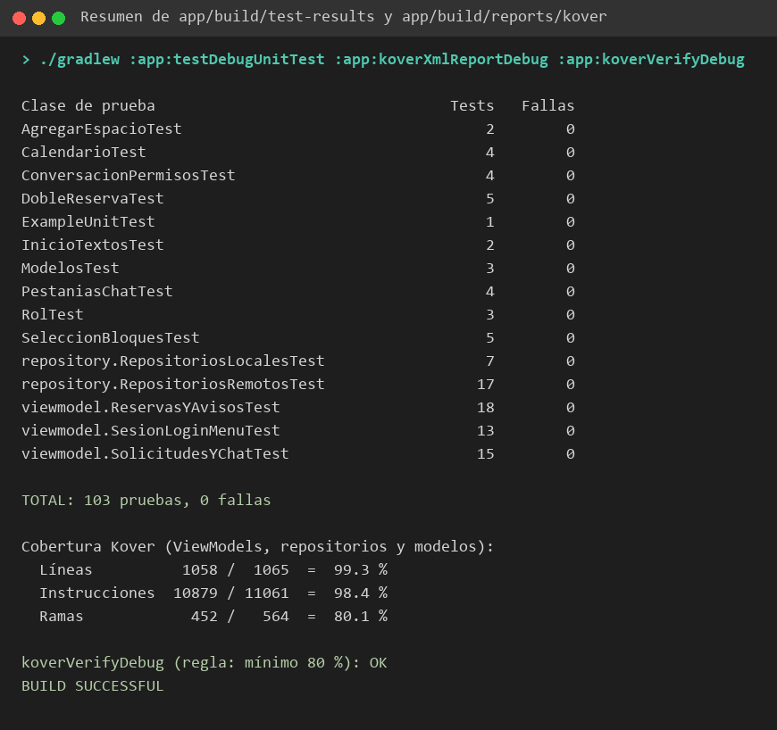
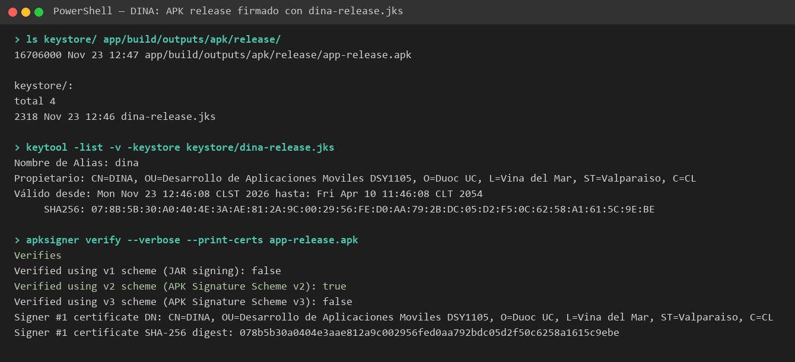

# DINA - Sistema de Reserva de Espacios Duoc UC

DINA es una aplicación móvil nativa para Android desarrollada en **Kotlin** con **Jetpack Compose**, respaldada por un microservicio propio desarrollado en **Spring Boot** desplegado en la nube (**AWS EC2**). Su objetivo principal es resolver la problemática de gestión y reserva de espacios en las sedes de Duoc UC, garantizando la eliminación de reservas duplicadas o cruces de horarios.

---

## 1. Integrantes del Equipo:

* **Nombre Integrante 1:** Exequiel Guzman
* **Nombre Integrante 2:** Víctor Godoy
* **Asignatura:** Desarrollo de Aplicaciones Móviles (DSY1105) - Sección 007D
* **Docente:** Nancy Bernal
* **Institución:** Duoc UC - Sede Viña del Mar

---

## 2. Funcionalidades Principales:

###  Autenticación y Control de Roles
* **Inicios de Sesión según Dominio:** Identificación automática de rol mediante el correo institucional:

  * `@duocuc.cl`: Estudiantes.
  * `@profesor.duoc.cl`: Docentes.
  * **Administrador:** Otorgado desde el backend para gestión completa del sistema.
* **Sesión Persistente:** Almacenamiento seguro de tokens Bearer usando **Jetpack DataStore**.
* **Gestión de Perfil:** Carga y recorte automático de fotos de perfil a 512px JPEG.

### Catálogo de Espacios y Reserva de Bloques
* **Catálogo Completo:** Visualización de los 79 espacios de la sede (Salas, Laboratorios, Talleres, Auditorios).
* **Reserva Flexible:** Selección de 1 a 4 bloques horarios consecutivos de 1 hora, con anticipación máxima de 30 días.
* **Validación de Cruces:**
  * Algoritmo backend que detecta solicitudes en conflicto. Al aprobar una solicitud, las solicitudes competidoras para el mismo espacio y bloque se rechazan automáticamente.
  * Detección de "Cruce Propio" (error HTTP 409): si un docente intenta pedir otro espacio a la misma hora, la app advierte antes de confirmar.

### Chat en Tiempo Real y Notificaciones
* **Chat por Solicitud Aprobada:** Comunicación directa entre el usuario solicitante y el administrador de la sede, con actualización periódica automática cada 5 segundos.
* **Centro de Avisos/Notificaciones:** Alertas interactivas con gestos de deslizamiento (*swipe to delete*), opción de **Deshacer** (10s) y eliminación masiva con confirmación.
* **Recordatorios de Reserva:** Notificación automática enviada 1 hora antes del inicio de la reserva.

### Integración de API Externa
* **Feriados de Chile (Nager.Date):** Consulta en tiempo real de feriados nacionales mediante Retrofit para alertar al usuario en la pantalla de reserva si la sede estará cerrada o con horario especial.

---

## 3. Endpoints Utilizados:

### API Externa (Nager.Date)
Servicio público de terceros consumido con un cliente Retrofit independiente sin envío de tokens de sesión:
* `GET https://date.nager.at/api/v3/PublicHolidays/{anio}/CL`: Obtiene el listado de feriados nacionales de Chile para el año seleccionado.

### Microservicio Propio (`dina_backend` en Spring Boot)
Desplegado en AWS EC2 en `http://34.201.191.7:8080/api`:

#### Sesión y Autenticación
* `POST /api/auth/login`: Autenticación con correo y contraseña. Retorna token Bearer.
* `GET /api/auth/me`: Obtiene los datos del usuario autenticado actual.
* `POST /api/auth/logout`: Invalida el token en el servidor.

#### Espacios y Bloques Horarios
* `GET /api/espacios`: Lista el catálogo completo de espacios.
* `GET /api/espacios/{id}`: Detalle de un espacio específico.
* `GET /api/espacios/{id}/disponibilidad?fecha=YYYY-MM-DD`: Consulta disponibilidad por bloques para un día.
* `GET /api/bloques`: Lista los 14 bloques horarios oficiales de la sede.
* `GET /api/edificios`: Lista los edificios de la sede.
* `POST /api/admin/espacios`: *(Admin)* Crear nuevo espacio.

#### Solicitudes de Reserva
* `POST /api/solicitudes`: Crear una nueva solicitud de reserva (1 a 4 bloques).
* `GET /api/solicitudes/mias`: Lista de solicitudes del usuario logueado.
* `GET /api/solicitudes/{id}`: Consulta detalle de una solicitud.
* `PATCH /api/solicitudes/{id}/cancelar`: Cancelar una solicitud pendiente o aprobada.

#### Administración de Solicitudes (Admin)
* `GET /api/admin/solicitudes`: Lista global de solicitudes (filtrables por estado).
* `PATCH /api/admin/solicitudes/{id}/aprobar`: Aprobar solicitud (rechaza automáticamente las conflictivas).
* `PATCH /api/admin/solicitudes/{id}/rechazar`: Rechazar solicitud con motivo.
* `PATCH /api/admin/solicitudes/{id}/cancelar`: Cancelar solicitud aprobada (motivo obligatorio).

#### Chat y Mensajería
* `GET /api/chats`: Lista de chats activos según estado de solicitud.
* `GET /api/chats/{id}?despuesDe=timestamp`: Obtiene nuevos mensajes de la conversación.
* `POST /api/chats/{id}/mensajes`: Envía un mensaje en el chat.
* `PATCH /api/chats/{id}/cerrar`: Cierra el chat de la reserva.

#### Notificaciones y Avisos
* `GET /api/notificaciones`: Lista de notificaciones del usuario.
* `GET /api/notificaciones/no-leidas`: Conteo de avisos sin leer.
* `PATCH /api/notificaciones/{id}/leida`: Marcar notificación individual como leída.
* `PATCH /api/notificaciones/leer-todas`: Marcar todas como leídas.
* `DELETE /api/notificaciones/{id}`: Eliminar una notificación.
* `DELETE /api/notificaciones`: Eliminar todas las notificaciones.

#### Perfil y Usuario
* `PUT /api/usuarios/me/foto`: Actualizar foto de perfil (Multipart / JPEG).
* `DELETE /api/usuarios/me/foto`: Eliminar foto de perfil.
* `GET /api/usuarios/{id}/foto`: Obtener imagen de perfil de un usuario.

#### Salud del Servidor
* `GET /api/salud`: Verificación del estado del microservicio (sin token).

---

## 4. Pasos para Ejecutar la Aplicación:

### Requisitos Previos
* **Android Studio** (2024.2 o superior).
* **JDK 17** configurado en Android Studio.
* Emulador de Android con **API 24+ (Android 7.0 o superior)** o un dispositivo físico Android.

### Instrucciones de Instalación y Ejecución

1. **Clonar el repositorio:**
   ```bash
   git clone https://github.com/Exe25GB/DINA.git
   cd DINA
   ```

2. **Abrir el proyecto en Android Studio:**
   * Abre Android Studio, selecciona **Open** y navega a la carpeta clonada `DINA`.
   * Espera a que **Gradle Sync** finalice la descarga de dependencias.

3. **Seleccionar la Variante de Compilación (Build Variant):**
   * Abre la pestaña **Build Variants** (abajo a la izquierda en Android Studio).
   * **`aws` (Por defecto):** Se conecta automáticamente al backend desplegado en la nube de AWS EC2.
   * **`debug`:** Se conecta al servidor local en tu equipo utilizando `adb reverse`.

4. **Ejecutar la App:**
   * Haz clic en el botón **Run 'app'** (▶️) o presiona `Shift + F10`.

5. **Ejecución de Pruebas Unitarias:**
   * Para ejecutar la suite de 103 pruebas unitarias y verificar la cobertura con Kover:
   ```bash
   ./gradlew :app:testDebugUnitTest
   ./gradlew :app:koverHtmlReportDebug
   ```

### 🧪 Evidencia de Pruebas Unitarias y Cobertura (Kover)

| Resultado de Pruebas Unitarias y Cobertura |
| :---: |
|  |

---

## 5. Firma Digital del APK y Almacenamiento `.jks`:

El proyecto cuenta con la variante `release` configurada para la generación del ejecutable **APK firmado digitalmente**, cumpliendo con los estándares de seguridad V2 de Android (`apksigner`).

### Generación del APK Firmado desde Android Studio:
1. Ir a **Build > Generate Signed App Bundle / APK...**
2. Seleccionar **APK** y presionar **Next**.
3. Seleccionar la ruta del archivo `.jks`, ingresar el alias `key0` y su contraseña.
4. Seleccionar la variante de compilación `release`.
5. El APK firmado se genera en: `app/release/app-release.apk`.

### 📸 Captura de Evidencia del APK Firmado y Llave (.jks)

| Generación del APK Firmado en IDE y `.jks` |
| :---: |
|  |

---

## 6. Planificación y Trabajo Colaborativo (GitHub):

* **Estructura de Trabajo:** Avance organizado en historias de usuario, sprints, asignación de tareas por pareja y evidencias de commits en el historial de Git.
